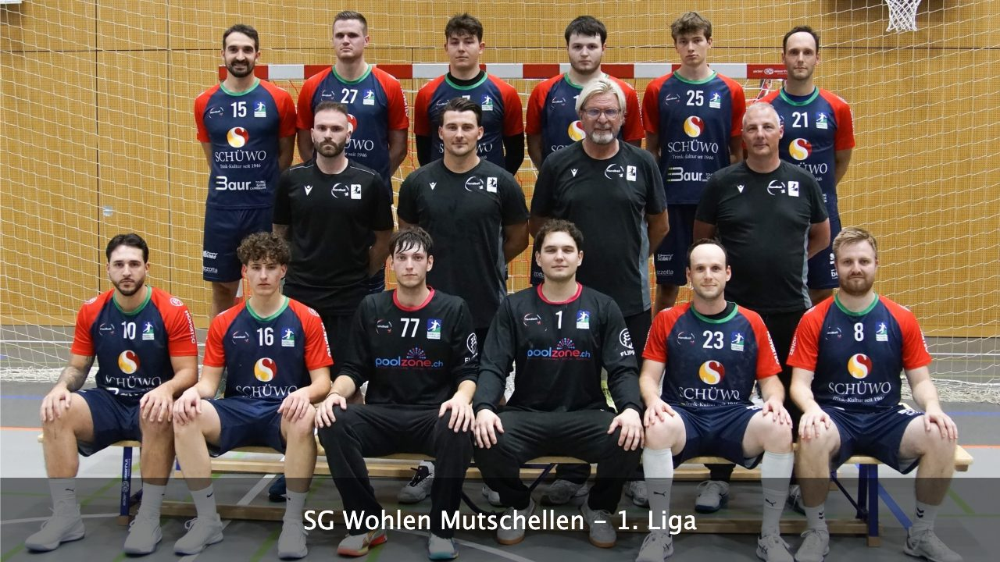
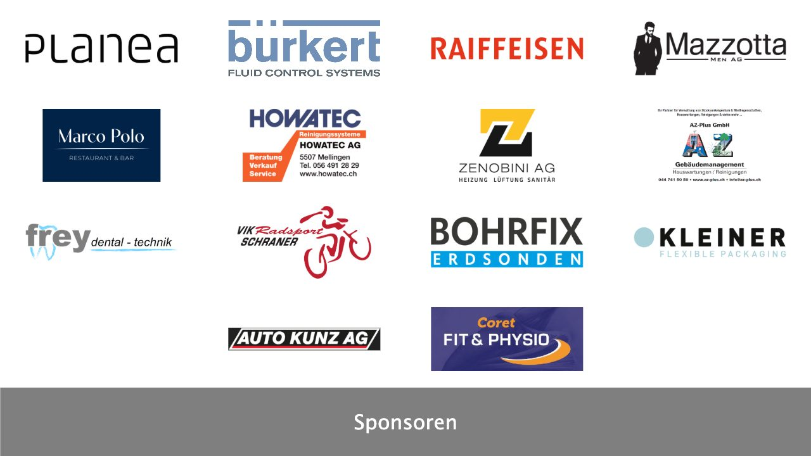

# Handball Screen

Slideshow für den Fernseher in der Halle Hofmatten 2 in Wohlen. Sie zeigt abwechselnd die Teams von [Handball Wohlen](https://www.handball-wohlen.ch) und ihre Sponsoren.

- **Live:** https://thankful-forest-081355703.5.azurestaticapps.net/
- **Alle Folien durchblättern:** https://thankful-forest-081355703.5.azurestaticapps.net/?demo
- **Raspberry Pi in der Halle:** [raspi/README.md](raspi/README.md)

<p>
  
  
</p>

## So funktioniert der Screen

- Alle 15 Sekunden wechselt er zwischen einem zufälligen Teamfoto und einer zufälligen Sponsorenfolie.
- Die Sponsorenlogos ordnen sich automatisch in einem Raster an, das zur Anzahl Logos passt.
- Die App ist für einen 4K-Fernseher mit 3840 × 2160 Pixeln gebaut.
- Ein Service Worker speichert die App und alle Bilder. So läuft der Screen auch ohne Internet und sucht alle 10 Minuten nach einer neuen Version.
- Jeder Push auf `main` wird über eine GitHub Action auf Azure Static Web Apps veröffentlicht.

## Teams und Sponsoren aktualisieren

Alle Folien stehen in [`src/app/slides.ts`](src/app/slides.ts). Die Bilder liegen pro Saison in `src/assets/images/teams/<saison>/` und `src/assets/images/sponsors/<saison>/`, zum Beispiel `2026-27`.

- **Teamfotos:** JPG in 3840 × 2160 Pixeln, von [handball-wohlen.ch](https://www.handball-wohlen.ch)
- **Sponsoren:** Logos als PNG, JPG oder SVG. Privatsupporter stehen ohne Logo mit Name und Ort auf der Folie.

Mit `?demo` lassen sich alle Folien einzeln durchblättern, mit `?demo&index=3` öffnet sich direkt eine bestimmte.

## Entwicklung

Voraussetzung ist Node.js 22 ab 22.22.3, 24 ab 24.15 oder 26 und neuer.

```bash
npm install
```

```bash
npm start
```

Der Dev-Server läuft auf http://localhost:4200/. Der Service Worker ist nur im Produktions-Build aktiv:

```bash
npm run build
```

Das Ergebnis liegt in `dist/handball-screen/browser`.
